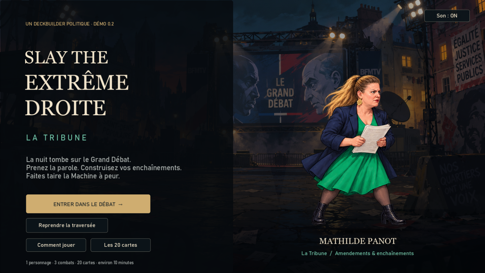
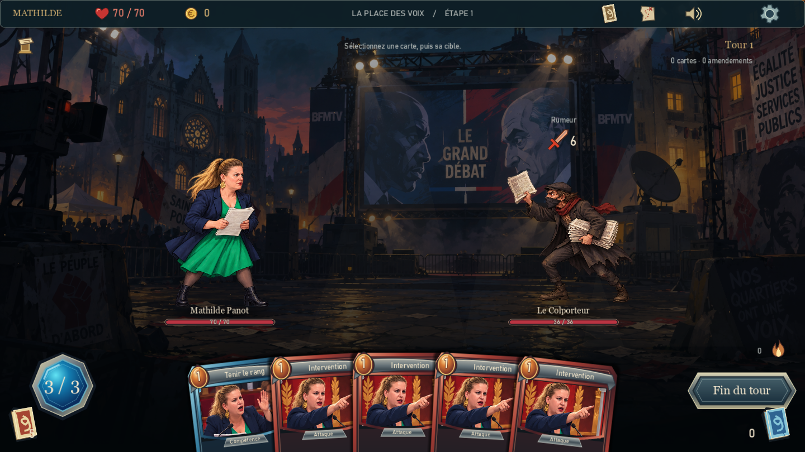
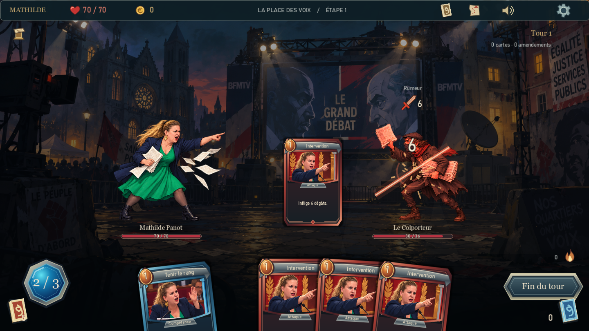
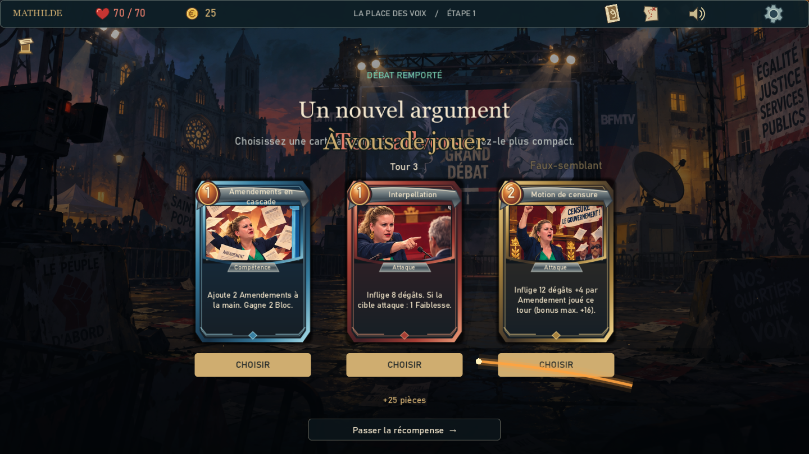

# Slay the Extrême Droite
### La Tribune

**Un jeu conçu par kingrabbit**

Un deckbuilder politique et satirique : prenez la parole, enchaînez les arguments et affrontez la Machine à peur.

**🚧 En développement · Démo jouable v0.2 · Windows 64 bits**

[**🎮 Télécharger la démo**](https://github.com/kingrabbit89/slay-the-extreme-droite/releases/download/v0.2.0/LaTribune-demo-v0.2-Windows.zip) · [**🎬 Voir un combat**](https://github.com/kingrabbit89/slay-the-extreme-droite/releases/download/v0.2.0/LaTribune-combat-v02.mp4) · [**💬 Faire un retour**](https://github.com/kingrabbit89/slay-the-extreme-droite/issues/new/choose)

## Prenez la parole

Incarnez **Mathilde Panot** dans une courte traversée de débats. Composez votre main, anticipez les intentions adverses et faites circuler vos Amendements pour construire vos enchaînements.

Un colporteur de rumeurs, un plateau hostile, une halte pour reprendre son souffle… puis le dernier mot face à la **Machine à peur**.

## Essayez la démo

**[Télécharger la démo Windows v0.2 — environ 46 Mo](https://github.com/kingrabbit89/slay-the-extreme-droite/releases/download/v0.2.0/LaTribune-demo-v0.2-Windows.zip)**

1. Téléchargez le ZIP dans la [release v0.2](https://github.com/kingrabbit89/slay-the-extreme-droite/releases/tag/v0.2.0).
2. Faites **Extraire tout**.
3. Ouvrez le dossier **LaTribune**, puis lancez **Jouer.cmd** ou **LaTribune.exe**.

Conservez les fichiers ensemble. Le jeu est autonome et fonctionne hors ligne : aucune installation de Godot, Rust ou Slay the Spire 2 n'est nécessaire. La musique est incluse.

> La démo est destinée aux premiers tests. Comptez environ **10 minutes** pour une traversée. Des changements importants de contenu, d'équilibrage et de présentation sont encore prévus.

## Déjà jouable

- **Un personnage**, un deck de départ et **20 cartes spécifiques**, avec des versions améliorées.
- Des combats au tour par tour : **3 énergies**, intentions visibles, Bloc, Faiblesse et Vulnérable.
- Des **Amendements** gratuits, des pouvoirs persistants, de la pioche et de l'épuisement.
- Un choix de parcours, des récompenses de cartes, une halte et un boss.
- Une main en éventail, des cartes animées entre les piles, des impacts, des boucliers et des annonces de tour.
- **Planète brûlée — Planète Boum Boum**, des bruitages et deux réglages de volume indépendants.
- Sauvegarde entre les étapes et option de mouvements réduits.

| Un argument qui porte | Un deck qui évolue |
| :---: | :---: |
|  |  |

**[Regarder 31 secondes de combat réel, avec le son](https://github.com/kingrabbit89/slay-the-extreme-droite/releases/download/v0.2.0/LaTribune-combat-v02.mp4)**

Toutes les images ci-dessus sont des captures de la démo jouable.

## Comment jouer

Survolez une carte pour la lire. Cliquez une Attaque, puis l'adversaire à cibler ; les Compétences se jouent directement. Les piles de cartes et les intentions se consultent dans l'interface.

| Commande | Action |
| --- | --- |
| **E** | Terminer le tour |
| **1–9 / 0** | Sélectionner une carte |
| **D** | Ouvrir le deck |
| **Échap** | Annuler le ciblage / ouvrir la pause |
| **F11** | Passer en plein écran |
| **M** | Couper / rétablir le son |

La pause permet de régler séparément la musique et les bruitages. Quitter pendant un combat permet de reprendre avant ce combat.

## Le jeu est en développement

Cette version est une **première démo**, pas le jeu complet. La suite du projet vise notamment :

- D'autres personnages et leurs mécaniques.
- Davantage de cartes, ennemis, rencontres et parcours.
- Des boutiques, des événements et plusieurs actes.
- Des personnages réellement articulés et des animations plus riches.
- Un travail continu sur la lisibilité, le son et l'équilibrage.

Les personnages actuels utilisent des poses et des déformations légères ; les pièces n'ont pas encore de boutique où être dépensées. Ces éléments évolueront avec le développement. Il n'y a pas de date annoncée pour une version complète.

## Vos retours font avancer le projet

Un combat trop facile ? Une carte incompréhensible ? Un effet qui manque d'impact ?

**[Donner un avis ou signaler un problème](https://github.com/kingrabbit89/slay-the-extreme-droite/issues/new/choose)**

Pour un bug, indiquez la version, les étapes pour le reproduire et votre configuration Windows. Une capture ou une courte vidéo est bienvenue. Les retours sur le plaisir de jeu, le rythme, les animations et la difficulté sont tout aussi utiles.

## Sous le capot

**Rust** porte les règles, les commandes, les piles de cartes et les sauvegardes. **Godot 4.5** assure l'interface, le rendu, les animations et l'audio, via une GDExtension native.

Le cœur de règles dispose de **19 tests automatisés**. Un test d'intégration rejoue une traversée jusqu'à la victoire dans l'exécutable Windows.

- [Développement et compilation](docs/DEVELOPPEMENT.md)
- [Architecture](docs/ARCHITECTURE.md)
- [Vérifications](docs/VALIDATION.md)
- [Crédits](docs/CREDITS.md) · [Ressources](docs/ASSETS.md) · [Composants tiers](docs/THIRD_PARTY.md)

---

**Conception et direction du projet : kingrabbit.**  
**Musique : [Planète brûlée](https://www.youtube.com/watch?v=Tph7Z_ypxgk) — [Planète Boum Boum](https://linktr.ee/planeteboumboum).**  
Projet indépendant, inspiré des jeux de construction de deck comme Slay the Spire. Non affilié à Mega Crit.
